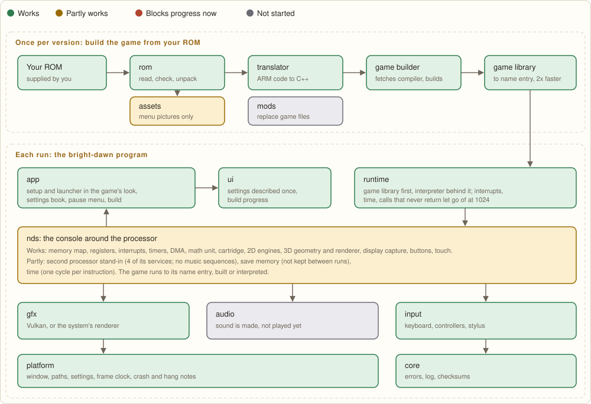

# Bright Dawn

Bright Dawn is a native PC version of *Golden Sun: Dark Dawn* (Nintendo DS,
2010), made by static recompilation: the game's own code, read from a ROM you
supply, is translated to C++ and compiled for your computer, with an
interpreter behind it for whatever is not translated. The aim is one unified
screen, high-resolution and widescreen rendering, controller-first input, and
packs for textures, models and music. It runs on Windows and Linux.

To try it, download the latest pre-release for Windows or Linux from the
[Releases page](https://github.com/BoneyKK/Bright-Dawn/releases): each one
says how to start it, the controls, and what changed since the last one.

## ROM and asset disclaimer

**Bright Dawn contains no part of the game.** This repository and its
packages hold no ROM, no game code, no pictures, no sound and no other game
data, and they never will. To play, you need a ROM image dumped from a
cartridge of the game that you own. Please do not ask for ROMs, or post
links to them or any game data, in issues.

Everything Bright Dawn takes from the game is read from your own ROM on your
own computer, while it runs: the launcher's pictures and font, and the game's
code that the game builder translates and compiles. What it makes from your
ROM stays in your per-user data directory. 

Recognised releases, by cartridge game code: `BO5E` (USA), `BO5P` (Europe),
`BO5J` (Japan).

*Golden Sun* is a trademark of Nintendo. Bright Dawn is a fan project, not
affiliated with or endorsed by Nintendo or Camelot Software Planning.

## Roadmap and current state

In short: **not playable yet.** The game runs through its opening to the name
entry, built or interpreted, and has not been tried beyond that. There is no
sound, and the game's save is not kept between runs. Every part in detail:
[docs/STATUS.md](docs/STATUS.md). 

The project map below shows each part of Bright Dawn, how the parts connect,
the state of each, and what comes next. 

<!-- project-map:start: made by tools/status/render_map.py from tools/status/project_map.json; change that file, not this part -->
**Last change** (17 November 2026): The project map is shown in the README too; pre-release descriptions start with the state; README restructured

| Part | Status | Now |
| --- | --- | --- |
| `rom` | 🟢 Works | Checks the ROM, reads its file system, archives and every kind of compression the game uses. |
| `assets` | 🟡 Partly works | Decodes the menus' pictures and the game's font (NFTR) for the launcher. Textures, models and sounds: not yet. |
| `mods` | ⚪ Not started | Planned: replace game files without changing the ROM. |
| `translator` | 🟢 Works | Translates 17,076 functions of the game's code to C++, on your computer, with interrupt polls and instruction counts. |
| `game builder` | 🟢 Works | Downloads its compiler (and Python on Windows) for the build and deletes it after. The downloaded compiler is not yet tried on a real build. |
| `game library` | 🟢 Works | Builds, loads and runs: reaches the name entry like the interpreted game, about twice as fast (600 frames in 11 s instead of 24). |
| `runtime` | 🟢 Works | Runs translated code with the interpreter behind it. Interrupts are taken where translated code polls for them. Calls that never return no longer pile up until the program crashes (the Windows crash after about 7 minutes). |
| `nds` | 🟡 Partly works | The console model runs the game to its name entry. No music, saves not kept between runs, beyond the name entry not yet tried. |
| `gfx` | 🟢 Works | Both screens in one window, any size, stacked or side by side, sharp pixels with smooth edges. Drawn through Vulkan, or the system's renderer where there is none. Widescreen and sharper 3D: not yet. |
| `audio` | ⚪ Not started | The sound hardware is modelled, but nothing plays it to your speakers. |
| `input` | 🟢 Works | Keyboard, any number of controllers, the mouse as the stylus. |
| `ui, app` | 🟢 Works | Setup and launcher look like the game's settings menu: its board, ribbon, parchment, buttons, message bar and font, from your ROM. Settings book, pause menu. |
| `platform, core` | 🟢 Works | Window, files, settings, frame timing, log, checksums. A crash is noted with where it happened; a game that stops finishing frames too. |
| `CI and releases` | 🟢 Works | Every change is built and tested on Linux and Windows; green changes on main become a pre-release. Its description gives the state first, then the big changes since the last one. |

**Next:**

1. Play on from the name entry, by hand and with scripted input, and fix what stops the game.
2. Music: the second processor's sequence player, and sound out of your speakers.
3. Saves kept between runs.
4. Widescreen, sharper 3D, and mods.

The same, as a page of its own: [the project map](https://claude.ai/artifact/Gt9rSTaUus5uaPnmhWNwN8).
<!-- project-map:end -->

## Credits and thanks

Bright Dawn stands on the work of these projects and people. Thank you.

| Who | What Bright Dawn takes from it | Licence |
| --- | --- | --- |
| [SkyEmu](https://github.com/skylersaleh/SkyEmu), by Skyler "Sky" Saleh | Its ARM core (`third_party/skyemu`), the interpreter behind the translated code | MIT |
| [Dear ImGui](https://github.com/ocornut/imgui), by Omar Cornut | Draws the launcher, the settings book and the pause menu (`third_party/imgui`) | MIT |
| [SDL 3](https://libsdl.org), by Sam Lantinga and the SDL contributors | The window, drawing (Vulkan and the system's renderers), input, controllers; downloaded and built in by the build | zlib |
| [Zig](https://ziglang.org), by the Zig Software Foundation | The compiler the game builder downloads to build the game from your ROM (from the [`ziglang`](https://pypi.org/project/ziglang/) package) | MIT |
| [LLVM and Clang](https://llvm.org), by the LLVM project | The C++ compiler inside Zig; also used by the tests to build ARM test programs | Apache-2.0 with LLVM exceptions |
| [Python](https://www.python.org), by the Python Software Foundation | Runs the game builder and the translator; downloaded for the build on Windows if not installed | PSF License |
| [NooDS](https://github.com/Hydr8gon/NooDS), by Hydr8gon | A reference for the console's behaviour, such as the second processor's start-up handshake; no code taken | GPL-3.0-or-later |
| [melonDS](https://melonds.kuribo64.net), by Arisotura and the melonDS team | The model for the default screen filter, sharp pixels with smooth edges; no code taken | GPL-3.0-or-later |
| [GBATEK](https://problemkaputt.de/gbatek.htm), by Martin Korth | The documentation of the DS hardware that much of the console model is written from | No licence stated; used as documentation only |
| [DSDecmp](https://github.com/barubary/dsdecmp), by barubary | Its Golden Sun plugin, the only public description of the LZ40 compression, which the first decoder was written from; no code taken | MIT |
| DS Asset Lab, by BoneyKK | The parts of the translator from this earlier project (`tools/translator/dslab`), placed by its author under this project's licence | GPL-3.0 |
| *Golden Sun: Dark Dawn*, by Camelot Software Planning, published by Nintendo | The game itself, which you supply | Not included |

The packages carry the licences of the code built into them, in `licenses/`.

## Licence

Bright Dawn is under the GPL-3.0; see [LICENSE](LICENSE). `third_party/skyemu`
and `third_party/imgui` are under the MIT licence, each with its licence
alongside.
